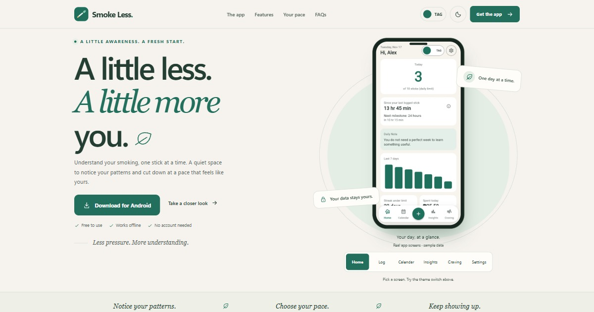

  

<h1 align="center">Smoke Less</h1>

  <strong>A little less, at your own pace.</strong> 
  The official showcase website for Smoke Less, an offline cigarette tracker for Android.

  <a href="https://smokeless-cmndrpaul.pages.dev/">Visit the website</a> ·
  <a href="https://www.mediafire.com/file/2id0ji2y6kd9azn/Smoke-Less-1.0.1-universal.apk/file">Download the Android app</a> ·
  <a href="https://github.com/cmndrpaul/smokeless-usage">Application repository</a>

## About

Smoke Less helps people become aware of their smoking habits and cut down gradually. It offers a supportive space to track cigarettes, notice patterns and choose a manageable next step.

This website introduces the app, lets visitors explore its screens, and provides the Android APK and installation guidance. It is a showcase, not a browser version of the tracker.

## Explore the website

| Feature | Experience |
| --- | --- |
| Interactive phone preview | Browse Home, Log, Calendar, Insights, Craving and Settings using real app screenshots. |
| Synchronized dark mode | Switch the website and app previews between light and dark together. |
| English and Taglish | Explore the content and screenshots in either language. |
| Spending calculator | Estimate weekly and monthly spending using sticks per day and price per stick. |
| App feature showcase | Learn about logging, gradual goals, reminders and craving support. |
| Download and installation guide | Get the APK and understand Android installation prompts. |
| Release notes and FAQs | See what changed and find answers about updates, reminders and local data. |

The design uses Smoke Less’s green palette, cigarette-and-leaf logo, phone mockups and subtle motion. Layouts adapt to phone, tablet and desktop windows, with keyboard navigation and reduced-motion support.

## About the Android app

- Log cigarette counts, brands, prices, moods and triggers.
- Reuse brands entered through **Other** on future logs.
- Review a calendar, spending estimates, trends and common triggers.
- Set daily limits and gradual taper plans.
- Choose optional local reminders and evening check-ins.
- Take a five-minute breathing break during a craving.
- Read daily notes and general quitting milestones.
- Use English or Taglish, with light, dark or system appearance.

The current download is **Smoke Less 1.0.1**, a universal APK for **Android 7.0 and newer**. The app is free to download and use, with no subscriptions or ads inside it. MediaFire’s external download page may display ads.

## Privacy

The Android app works offline, requires no online account, and stores records on the phone. Uninstalling it or clearing its storage deletes those records; there is no cloud recovery.

The website remembers only theme and language preferences in the visitor’s browser. Calculator inputs stay in the current tab. No analytics scripts, feedback forms or backend are included in this website.

Preview screenshots use illustrative sample records, not private user data. Smoke Less is a tracking and awareness tool, not medical advice or treatment.

## Built with

**HTML · CSS · JavaScript · Cloudflare Pages**

A static website with no runtime packages or database. The Android application is built separately with Flutter and local SQLite storage.

---

Created by [cmndrpaul](https://github.com/cmndrpaul).
